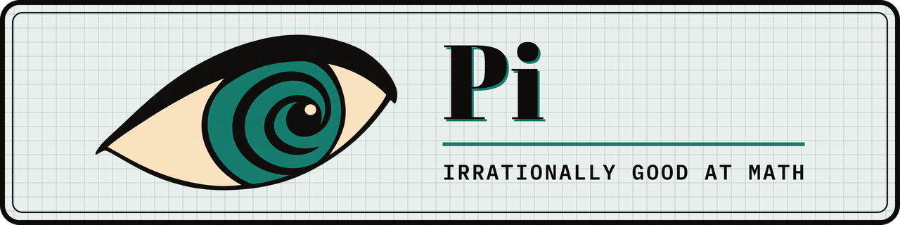

[](https://github.com/Pi-Mathematical-Reasoning)

# pi-branding

[](https://github.com/Pi-Mathematical-Reasoning/pi-branding/releases/latest)
[](https://github.com/Pi-Mathematical-Reasoning/pi-branding/actions/workflows/ci.yml)
[](https://github.com/Pi-Mathematical-Reasoning/pi-branding/blob/main/LICENSE)

The Pi brand in one place: the spiral eye logo, the avatar for the
organization and its GitHub Apps, the banner every Pi README opens with, the
social preview, and the standard for README headers. It is part of
[Pi](https://github.com/Pi-Mathematical-Reasoning/pi), a small open-weight
model trained deeply in mathematics, whose proofs are checked by Lean 4.
Other repositories link to the files here instead of copying them, so a
change to the brand reaches every one of them without a pull request.

## Assets

Every path below is **published**: other repositories link to it on `main`,
so it is never moved, renamed or removed. What is drawn at a path can change
freely.

| Asset | Path | Size | Used for |
|---|---|---|---|
| Logo | [`assets/logo/pi-logo.png`](assets/logo/pi-logo.png) | 1024 × 1024, transparent | Anywhere that supplies its own background |
| Avatar | [`assets/avatar/pi-avatar.png`](assets/avatar/pi-avatar.png) | 1024 × 1024, graph-paper background | The `Pi-Mathematical-Reasoning` organization picture, and the logo of `pi-release-bot` |
| README banner | [`assets/banner/pi-readme-banner.png`](assets/banner/pi-readme-banner.png) | 1280 × 320 | The first line of every Pi README, and the organization profile |
| Social preview | [`assets/social/pi-social-preview.png`](assets/social/pi-social-preview.png) | 1280 × 640, opaque | Each repository's social preview image (Settings → General → Social preview) |

The raw URL of any asset is
`https://raw.githubusercontent.com/Pi-Mathematical-Reasoning/pi-branding/main/<path>`.

The avatar keeps the eye inside the circle GitHub crops avatars to: the eye's
corners are points on its horizontal midline, so it can run nearly the full
width. Like the banner and the social preview, it sits on graph paper: a
cool off-white with a faint grid, which marks Pi as a mathematics project
and keeps it distinct from the warm paper of other brands. The avatar's grid
is coarser than the banner's so it still reads at small sizes. When a GitHub
App asks for a badge background color, use the paper color `#E9EFEC`.

Pi has no website yet, so there are no favicons. They are added here, from
the same script, when one exists.

## README headers

Every Pi repository's README opens with the same three parts, in this order:

1. **The shared banner**, linked to the organization. Link to it; never copy
   it into the repository, or a change to the brand will not reach it.
2. **The repository's name** as the only level-one heading.
3. **The repository's own badges**, one per line in a single paragraph. Which
   badges a repository shows is its own choice. Use
   [shields.io](https://shields.io) badges in the default flat style, or the
   GitHub Actions badge for CI, and put them in this order where they apply:
   package or registry version, release, CI, license, then anything else the
   repository adds.

Then one paragraph that says what the repository is, linking to
[Pi](https://github.com/Pi-Mathematical-Reasoning/pi).

Copy this block and replace `<repo>` and the badges:

```markdown
[](https://github.com/Pi-Mathematical-Reasoning)

# <repo>

[](https://github.com/Pi-Mathematical-Reasoning/<repo>/releases/latest)
[](https://github.com/Pi-Mathematical-Reasoning/<repo>/actions/workflows/ci.yml)
[](https://github.com/Pi-Mathematical-Reasoning/<repo>/blob/main/LICENSE)

What this repository is, in one paragraph. It is part of [Pi](https://github.com/Pi-Mathematical-Reasoning/pi).
```

The banner and badges use Markdown image syntax with absolute URLs, not HTML
or relative paths, so every place that renders a README (GitHub, package
registries, mirrors) shows the header the same way.

## Palette and type

Ink, Cream and Teal are sampled from the logo; Paper and Grid make the graph
paper behind it.

| Name | Hex | Use |
|---|---|---|
| Ink | `#0E0C0B` | The eye's outline, lid and pupil, the wordmark, text |
| Cream | `#FBE3C0` | The eye's sclera and highlight |
| Teal | `#147C6C` | The spiral iris; the wordmark's shadow and the banner's rule |
| Paper | `#E9EFEC` | Backgrounds behind the logo: the banner card, the social preview and the avatar |
| Grid | `#C3D3D0` | The graph-paper grid on Paper |

The wordmark, **Pi**, is set in
[Abril Fatface](https://fonts.google.com/specimen/Abril+Fatface), a
high-contrast display serif in the tradition of classic mathematical
typesetting. The tagline, **IRRATIONALLY GOOD AT MATH**, is set in
[IBM Plex Mono](https://fonts.google.com/specimen/IBM+Plex+Mono) SemiBold.
Both are in `fonts/` under the SIL Open Font License, which is next to each
font file.

## Changing the brand

Every asset is drawn by [`scripts/render.py`](scripts/render.py) from the
original logo in `source/` and the fonts in `fonts/`. To change one, edit the
script and render again:

```sh
uv run scripts/render.py           # writes every asset
scripts/check.sh                   # the same checks as CI
```

CI fails when a published path is missing or has the wrong size, and when a
committed asset no longer matches what the script draws. A redrawn asset is
a `feat`; moving or removing a published path is a breaking change (`feat!`)
and needs every repository that links to it updated first.

## License

Everything here, the artwork included, is MIT licensed; see
[LICENSE](LICENSE). The fonts keep their own SIL Open Font License.

Contribution rules are in [CONTRIBUTING.md](CONTRIBUTING.md); the rules for
coding agents are in [AGENTS.md](AGENTS.md).
